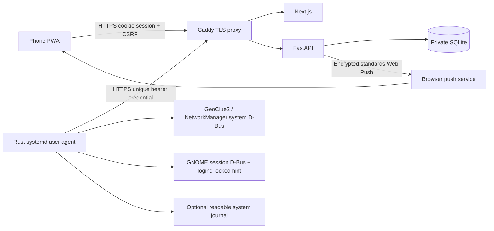

# Sentinel V1 implementation decisions

The repository started empty. The implementation uses the requested Rust/Tokio/Reqwest/Zbus agent, Python/FastAPI/SQLAlchemy/SQLite backend, and TypeScript/Next.js mobile PWA.

## Plan and completed software milestones

1. Foundation: owner provisioning, opaque cookie sessions, database, single-use enrollment and responsive dashboard.
2. Agent: protected enrollment/configuration, 60-second outbound heartbeats, persisted contact/results, systemd user service.
3. Location: owner opt-in GeoClue2 D-Bus requests, separately opted-in IP fallback, validated fixes, retained last-known coordinates, interactive map.
4. Lock: explicit confirmation, ownership checks, signed short-lived command delivery, persistent replay ledger, GNOME D-Bus action and session-state verification, audit trail.
5. Alerts: deterministic NetworkManager and journal rules, deduplication/cooldowns, minimal in-app records, durable Web Push outbox and retries.
6. Verification: automated backend and agent tests, production builds, deployment templates and targeted hardware checklist. See [VERIFICATION.md](VERIFICATION.md) for actual outcomes.

## Architecture

The laptop never accepts inbound requests. Both phone and laptop reach an independently hosted HTTPS server. One device per owner keeps the V1 UI and authorization model small. SQLite with one API worker also hosts the push worker; no Redis or message broker is needed.

## Location investigation

GeoClue2 exposes Manager.GetClient, Client.DesktopId, RequestedAccuracyLevel, Start, Location and Location.Latitude/Longitude/Accuracy/Timestamp. Sentinel uses the desktop ID `sentinel` and a street-level request. GeoClue chooses the actual provider; a Wi-Fi fix is possible only if the installed provider, GNOME permission agent and network support it. The source is labeled **GeoClue**, never misrepresented as GPS or guaranteed Wi-Fi. We do not change the laptop's global positioning provider.

GeoClue runs only when enabled during enrollment; each request is stopped/deleted after completion or timeout. Positioning is sampled at most once every five minutes and its original timestamp is preserved in intervening heartbeats, reducing provider traffic and power use. Permission failure is a real unavailable result. Provider requests may disclose nearby Wi-Fi information to that provider; read your `/etc/geoclue/geoclue.conf` and provider policy. Many distributions have changed positioning providers after older services closed. No provider is assumed operational.

The optional IP fallback calls `https://ipapi.co/json/` from the laptop, never from the phone or backend. It can locate an ISP exit or VPN rather than the laptop. The provider does not return an accuracy radius, so `accuracy_m` is **null** and the UI says unknown. No radius or coordinates are invented. Availability/rate limits depend on the third-party service. Each valid fix includes its real timestamp; the backend retains only the latest valid fix when acquisition fails. Map tiles load only after a dashboard action because the tile requests reveal the viewed area to OpenStreetMap.

## Online monitoring

The backend uses receipt time rather than the laptop's clock: online through 90 seconds since contact, stale through 180 seconds, then offline/unreachable. An enrolled laptop with no contact is unreachable. The UI polls every 30 seconds only while visible, and treats an unreachable backend or a dashboard snapshot over 45 seconds old as unverifiable. Loss of contact is never labeled theft. The agent retries on its normal 60-second cadence, avoids catch-up bursts, and persists results/events across restarts.

## Locking and command lifecycle

Only `lock` exists in the agent protocol; there is no executable command string. Backend TLS and device authentication protect transport. The command's HMAC-SHA256 binds UUID, device, action, issue time and expiry using the device credential that arrives with the authenticated heartbeat. The database stores only a SHA-256 credential digest, so the server can sign delivery without retaining plaintext device credentials. The validity window is 120 seconds. The agent rejects unexpected fields, invalid IDs/actions/devices/signatures, expiry and significant clock differences. Keep both machines synchronized with NTP.

`pending` means queued, `delivered` means the authenticated heartbeat received it, `successful` means GNOME reported active and logind reported the sole matching user's graphical session locked, `failed` means verification failed, and `expired` means no verified result reached the backend before expiry. Late acknowledgements cannot produce an optimistic success. Lost replies cause redelivery of the same UUID. The agent persists a consumed marker *before* any OS action and never repeats it; after a crash it reports `execution_interrupted` instead of guessing. A consumed ledger entry can be pruned after its expiry plus a grace interval because an expired replay cannot pass validation. A second running process is prevented by a file lock.

This is a user service, not a root/system locking daemon. It uses the user's bus `org.gnome.ScreenSaver.Lock` and checks `GetActive` plus `org.freedesktop.login1.Session.LockedHint`. GNOME versions lacking either interface, multiple graphical sessions, or a not-yet-logged-in desktop produce a failure. No generic privileged helper is needed and no Polkit root capability is installed.

## Alert rules

* **Network change:** hash NetworkManager's active connection UUID locally. A different profile must be observed twice consecutively (normally about two minutes). The first observation establishes a baseline. Disconnection alone is not a verified network change. Emit at most once per ten minutes. UUIDs/SSIDs/IP addresses are not uploaded. Changes of access point within the same saved profile are outside this V1 rule.
* **Repeated failures:** when the user has full system-journal read permission via `adm` or `systemd-journal`, read up to 1000 new journal records each cycle using a persisted cursor. Count canonical SSH password failure messages and PAM GDM/sudo authentication failures: at least five in a rolling five-minute interval, with a ten-minute cooldown. Old journal text and usernames never leave the laptop. Other authentication sources (fingerprint, smartcard, non-journal auth logs, differently formatted services) are not covered. Permission denied, absent logs, journal read errors or saturation are disclosed as monitoring limitations.
* The backend independently enforces the authentication count threshold, deduplicates event UUIDs and applies a ten-minute per-device/per-kind notification cooldown. Agent events queue for at most seven days and at most 100 records; long disconnections may lose subsequent alerts beyond this bound. An alert describes an observation, not proof of malicious activity.

Push delivery runs every 30 seconds from a persistent outbox, retries transient failures up to three attempts with exponential spacing, removes expired subscriptions, and reports delivery state in the in-app list. Delivery retries can repeat a push after an uncertain network outcome; a stable notification tag collapses duplicates. Push means the push service accepted a message, not that a human saw it. Only Chrome/Firefox/Apple standard push hosts are allowed to prevent subscription URL SSRF.

## Source references

* [GeoClue maintained source](https://gitlab.freedesktop.org/geoclue/geoclue) and [GeoClue D-Bus XML in Debian source](https://sources.debian.org/src/xdg-desktop-portal/1.20.3%2Bds-1/src/org.freedesktop.GeoClue2.Client.xml/).
* [systemd login1 D-Bus contract](https://www.freedesktop.org/software/systemd/man/latest/org.freedesktop.login1.html).
* [Next.js PWA guide](https://nextjs.org/docs/app/guides/progressive-web-apps).
* [IP fallback provider API](https://ipapi.co/api/).
